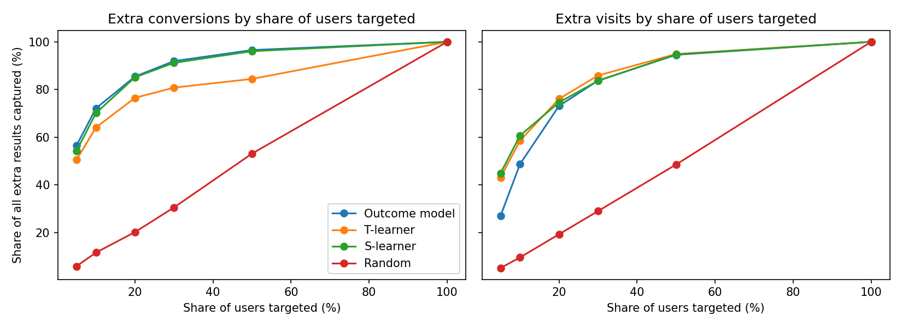

# When does the offline metric lie?

Does the model with the best AUC also create the most extra results? I tested this on a real randomised advertising experiment with about 14 million users.

**Short answer:** not always. For conversions, the model with the best AUC was also among the best at bringing extra conversions. For visits, AUC picked a model that captured far fewer extra visits when targeting a small group of users.



## Results

### 1. Did the ads work? ([notebook 1](notebooks/01_ab_test.ipynb))

| Outcome | Control | Treated | Absolute effect | Relative effect | 95% CI (points) |
|---|---|---|---|---|---|
| Visit | 3.82% | 4.85% | +1.03 points | +27.1% | 1.005 to 1.063 |
| Conversion | 0.19% | 0.31% | +0.115 points | +59.4% | 0.108 to 0.122 |

- Both effects are statistically significant (p < 0.001), and the groups are balanced on all 12 features (largest SMD: 0.049).
- This is an intention-to-treat effect. Only 3.6% of eligible users actually saw an ad.
- Per 1 million eligible users, that is about 1,150 extra conversions (95% CI: 1,084 to 1,219).
- A new 50/50 test would need about 29,000 users per group to detect this conversion effect (alpha 0.05, power 0.8), and about 105,000 to detect half of it.
- The effect is very uneven. In one exploratory segment, about 17% of users brought about 87% of that feature's extra conversions.

### 2. Does the best AUC bring the most extra results? ([notebook 2](notebooks/02_model_comparison.ipynb))

Share of all extra results captured by targeting the top-ranked users, on held-out test data. Averages over 5 random splits for conversion and 3 for visit.

| Outcome | Model | AUC | Top 5% | Top 10% | Top 20% |
|---|---|---|---|---|---|
| Conversion | Outcome model | **0.958** | 56% | 72% | 85% |
| | S-learner | 0.947 | 54% | 70% | 85% |
| | T-learner | 0.767 | 50% | 64% | 76% |
| | Random | 0.500 | 6% | 12% | 20% |
| Visit | Outcome model | **0.947** | 27% | 49% | 73% |
| | S-learner | 0.879 | **45%** | **61%** | 75% |
| | T-learner | 0.785 | 43% | 59% | 76% |
| | Random | 0.500 | 5% | 10% | 19% |

## Recommendation

- **Don't choose a targeting model on AUC alone.** AUC measures who converts, not who converts because of the ad. Compare models on incremental results using randomised holdout data.
- **Measure at the share of users you plan to target.** For visits, the models differ a lot at the top 10% and very little at the top 20%.
- **Don't assume uplift models are always better.** For conversions, the simple outcome model did as well as the S-learner and better than the T-learner, so it may be the cheaper choice.
- **Confirm in a live test.** This analysis has no costs or revenue, so it can't show whether a targeting policy would be profitable.

## Method

- **Notebook 1:** balance check (SMD), two-proportion z-tests, confidence intervals, power calculation, and segment effects with Benjamini-Hochberg correction.
- **Notebook 2:** 80/20 train/test split, LightGBM outcome model, T-learner and S-learner. Models are ranked by score, then the extra results in each top share are estimated by comparing treated and control users within it.

## Limits

- The data comes from web advertising, not mobile games.
- It pools several experiments without an experiment ID and was sub-sampled non-uniformly for privacy, so the rates aren't Criteo's real business rates, and some bias from pooling can't be ruled out.
- The features are anonymised, so segments can't be given a business meaning.
- The segment results are exploratory, because the segments were chosen after seeing the data.
- The models have only light tuning, and all splits come from the same dataset.
- I can't yet explain why the two outcomes behave differently.

## Data

[Criteo Uplift Prediction Dataset](https://ailab.criteo.com/criteo-uplift-prediction-dataset/), v2.1 (13,979,592 rows). It is not stored in this repo.

- Download `criteo-research-uplift-v2.1.csv.gz` from https://huggingface.co/datasets/criteo/criteo-uplift
- Save it as `~/data/criteo-uplift/criteo-uplift-v2.1.csv.gz`, or set `CRITEO_DATA_DIR` to another folder.

Citation: Diemert, E., Betlei, A., Renaudin, C., & Amini, M.-R. (2018). *A Large Scale Benchmark for Uplift Modeling*. AdKDD and TargetAd Workshop, KDD 2018. Licensed under CC BY-NC-SA 4.0.

## Setup

```
python -m venv .venv
.venv\Scripts\activate
pip install -r requirements.txt
jupyter notebook
```

Then open the notebooks in `notebooks/`. The repeated splits in notebook 2 take about 12 minutes.
